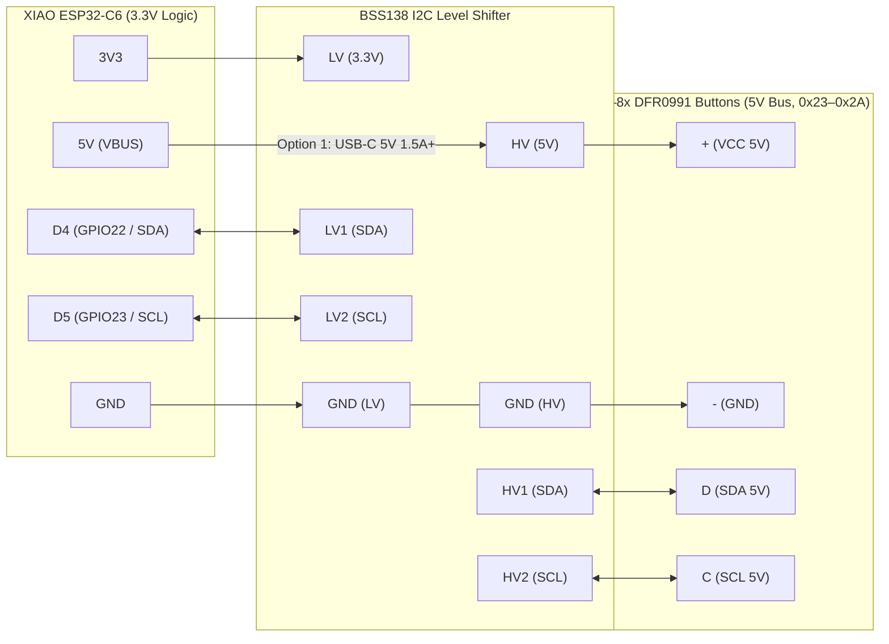

# 5V Upgrade Guide (DFR0991 RGB Buttons)

By default, **Milieu Panel** powers 1–8 [DFRobot Gravity I2C RGB LED Buttons (`DFR0991`)](https://www.dfrobot.com/product-2634.html) from the Seeed Studio XIAO ESP32-C6's `3V3` pin (see [HARDWARE_SPECIFICATION.md](HARDWARE_SPECIFICATION.md)). That keeps wiring dead simple (no level shifter), but limits total LED brightness to stay within the XIAO's `3V3` LDO power budget (`10%` default / `48%` recommended max for 8 buttons).

Powering the `DFR0991` modules from **5V** bypasses the XIAO's `3V3` regulator completely, unlocking **full `100%` (`PWM 255`) brightness** across all 8 buttons and giving Blue/Green LEDs ($V_f \approx 3.0\text{–}3.3\text{ V}$) proper voltage headroom for cleaner color balance.

> [!CAUTION]
> **Never connect 5V-powered `DFR0991` `SDA`/`SCL` lines directly to the XIAO ESP32-C6!**
> Each `DFR0991` module has built-in **`10 kΩ` pull-up resistors tied to its `VCC` (`+`) rail**. When powered at `5V`, `SDA` and `SCL` idle at **`5.0V`**, which exceeds the ESP32-C6's `3.3V` GPIO limit (`3.6V` abs max) and can permanently damage the board. **A bidirectional I2C logic level shifter is mandatory.**

---

## Parts Needed

| Part | Qty | Recommendation | Notes |
|------|-----|----------------|-------|
| **Bidirectional I2C Level Shifter** | **1** *(shared by all 1–8 buttons)* | **`BSS138`** MOSFET 2- or 4-channel breakout (e.g., SparkFun `BOB-12009`, Adafruit `757`) or **`PCA9306`** | Sits between the XIAO (`3.3V`) and the shared `5V` button I2C bus. **Do NOT use `TXB0104`/`TXB0108`** (incompatible with open-drain I2C) and avoid **`TXS0102`/`TXS0108E`** (can oscillate with multiple parallel `10 kΩ` pull-ups). |
| **5V Power Supply** | **1** | Regulated **5V ≥ 1.5A** (2A recommended) USB-C wall adapter or 5V PSU | Required for 8 buttons at `100%` white (`~850 mA` peak combined with ESP32-C6 Wi-Fi TX). |
| **Decoupling Capacitor** *(recommended)* | **1** *(shared on 5V rail)* | **`100 µF – 470 µF`** electrolytic (`≥ 10V`) | Placed once across the shared `5V` and `GND` rail near the button power bus to smooth LED and Wi-Fi current transients. |
| **Schottky Blocking Diode** *(Option 2A only)* | **1** | **`1N5819`** or **`SS14`** (`≥ 1A`) | Mandatory only when back-powering the XIAO's `5V` pin from an external 5V PSU while still using USB-C for flashing. |

---

## Architecture & Wiring Diagram



### Pin-by-Pin Connections

#### 1. Low-Voltage Side (`3.3V` — XIAO ESP32-C6 → Level Shifter)

| XIAO ESP32-C6 | Level Shifter (`LV` Side) | Purpose |
|---------------|---------------------------|---------|
| `3V3` | `LV` | `3.3V` logic reference |
| `GND` | `GND` | Common ground |
| `D4` (`GPIO22`) | `LV1` | `3.3V` I2C `SDA` |
| `D5` (`GPIO23`) | `LV2` | `3.3V` I2C `SCL` |

#### 2. High-Voltage Side (`5V` — Level Shifter → `DFR0991` Buttons `0x23`–`0x2A`)

| Level Shifter (`HV` Side) | `DFR0991` Bus (Parallel) | Gravity Wire | Purpose |
|---------------------------|--------------------------|--------------|---------|
| `HV` | `+` (`VCC`) | Red | `5.0V` power & pull-up reference |
| `GND` | `-` (`GND`) | Black | Common ground (tied to `LV` `GND`) |
| `HV1` | `D` (`SDA`) | Green | `5.0V` I2C `SDA` |
| `HV2` | `C` (`SCL`) | Blue | `5.0V` I2C `SCL` |

> [!TIP]
> **Power distribution for 5–8 buttons:** Feed `+` (`5V`) and `-` (`GND`) to the buttons from a common power rail/distribution header (with the `100 µF–470 µF` capacitor across `5V` and `GND`) rather than chaining long, thin jumper wires end-to-end. That avoids voltage sag on the farthest button.

---

## Choosing a 5V Power Topology

### Power Budget at 5V (Worst-Case Full White, `PWM 255`)

| Load | Draw |
|------|------|
| `DFR0991` MCU (`~2 mA` × 8) | `16 mA` |
| `DFR0991` RGB LEDs at `100%` white (`~60 mA` max × 8) | `480 mA` |
| XIAO ESP32-C6 (Wi-Fi TX peak / typical) | `354 mA` peak / `~100 mA` typ |
| **Combined Total (8 buttons @ `100%` white)** | **`~850 mA` peak / `~600 mA` typ** |

### Option 1 (Simplest — Recommended): Single USB-C Wall Adapter (`5V ≥ 1.5A`)
1. Power the XIAO ESP32-C6 through its **USB-C port** using a dedicated **5V ≥ 1.5A (or 2A)** USB wall charger.
2. Wire the XIAO's **`5V` (`VBUS`) pin** to the level shifter's `HV` pin and the `DFR0991` `+` (`VCC`) power bus.
3. **Why it works well:** One cable powers everything, with no back-feed diode needed.
4. **Watch out when plugged into a PC:** Standard computer USB 2.0 ports cap out at `500 mA`. While flashing/debugging on a laptop, either keep brightness ≤ `50%` or unplug some buttons if your PC port trips overcurrent protection.

### Option 2 (Best for Permanent Enclosures): Dedicated External 5V PSU (`≥ 1.5A`)
There are two safe ways to wire an external regulated `5V` power supply so plugging in USB-C never back-feeds your computer:

- **2A — Single PSU powering both buttons and XIAO (requires Schottky diode):**
  - Connect External `5V` directly to the `DFR0991` `+` (`VCC`) bus and level shifter `HV`.
  - Connect External `5V` → **Schottky diode (`1N5819` / `SS14`, anode on PSU, cathode/stripe on XIAO)** → XIAO **`5V` pin**.
  - Tie External `GND`, XIAO `GND`, level shifter `GND`, and button `GND` together.
  - *Why:* The XIAO ESP32-C6 has no internal inline blocking diode on `VBUS`. The Schottky diode prevents USB-C `5V` from flowing backward into your external PSU during flashing, while the `~0.35V` drop (`~4.65V` into the XIAO) still gives the onboard `3.3V` LDO plenty of headroom.
- **2B — Split power (zero diode needed):**
  - Power the XIAO via its **USB-C port** (leave the XIAO `5V` pin **unconnected**).
  - Power the `DFR0991` buttons and level shifter `HV` from the external `5V` PSU.
  - **Tie `GND` together** across XIAO, level shifter, buttons, and external `5V` PSU.

---

## I2C Pull-Up & Signal Integrity Notes at 5V

Each `DFR0991` includes onboard **`10 kΩ` pull-up resistors** on `SDA` and `SCL`, and a typical `BSS138` level shifter adds another `10 kΩ` on both `HV` and `LV`:

| Connected Buttons | Effective `HV` Pull-Up (`+ 10 kΩ` Shifter) | Total Sink Current (`I_OL`, `HV + LV`) | Notes |
|-------------------|--------------------------------------------|----------------------------------------|-------|
| **1 button** | `5.00 kΩ` | `1.33 mA` | Well within `3 mA` I2C Standard Mode spec |
| **4 buttons** | `2.00 kΩ` | `2.83 mA` | Within `3 mA` I2C Standard Mode spec |
| **8 buttons** | `1.11 kΩ` | `4.83 mA` | Works reliably at `100 kHz` on short runs; ESP32-C6 & `BSS138` handle this easily |

* **Keep I2C at `100 kHz`** (already the default in both firmwares) and do **not** add external pull-up resistors.
* **Long wires with 6–8 buttons:** If you ever see intermittent I2C NACKs/timeouts on a large panel with long cables, lower the I2C bus frequency to `50 kHz`—or use a **`TCA9548A` / `PCA9548A`** I2C multiplexer (which both splits the bus capacitance/pull-ups and supports `3.3V`↔`5V` translation when powered at `3.3V` with `5V`-pulled channels).

---

## Firmware Changes to Unlock Full Brightness

Both firmwares intentionally cap brightness to protect the `3V3` rail out of the box. After verifying your 5V wiring, update the cap for whichever firmware you use:

### Option A: Matter Firmware ([`sketches/milieuMatter/config.h`](sketches/milieuMatter/config.h))
Increase `LED_PWM_ON` (line 27) from `26` (`10%`) up to `255` (`100%`)—for example `128` (`50%`) or `255` (`100%`):
```cpp
constexpr uint8_t LED_PWM_ON = 255; // 100% brightness (5V upgrade only)
```

### Option B: ESPHome Firmware
1. Raise the `48%` (`0.48`) safety ceiling to `100%` (`1.0`) in:
   - [`esphome/components/milieu_panel/__init__.py`](esphome/components/milieu_panel/__init__.py) (`cv.Range(min=0.01, max=1.0)`)
   - [`esphome/components/milieu_panel/milieu_panel.cpp`](esphome/components/milieu_panel/milieu_panel.cpp) (`std::min(1.0f, max_brightness)`)
2. Set `max_brightness` in [`esphome/packages/milieu-panel-base.yaml`](esphome/packages/milieu-panel-base.yaml) (Home Assistant's `0–100%` brightness slider will scale linearly up to this ceiling):
   ```yaml
   milieu_panel:
     id: milieu_hub
     i2c_id: bus_i2c
     max_brightness: 100%
   ```

---

## Pre-Power Checklist

1. **Double-check `LV` vs `HV` orientation** on the `BSS138` shifter (`3V3` on `LV`, `5V` on `HV` — never reversed).
2. **Verify common `GND`** between XIAO, level shifter (`LV` & `HV` `GND`), buttons, and any external `5V` PSU.
3. **Measure voltages before attaching the XIAO `D4`/`D5` pins** (optional but safest): with power on, confirm `LV`, `LV1`, and `LV2` measure `~3.3V` (never `> 3.6V`), and `HV`, `HV1`, and `HV2` measure `~5.0V`.
4. **If using Option 2A (external PSU → XIAO `5V` pin):** confirm the Schottky diode stripe (cathode) faces the XIAO's `5V` pin before plugging in USB-C.
5. **Confirm unique DIP switch addresses** (`0x23`–`0x2A`) on every `DFR0991` module (see [HARDWARE_SPECIFICATION.md](HARDWARE_SPECIFICATION.md#dip-switch-addresses)).
