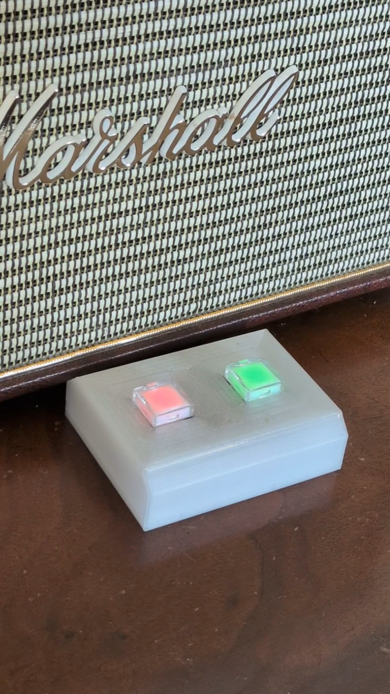

# Milieu Panel

> **Smart buttons that don't lie to your face.** 🎨🔘
>
> Most buttons blindly flip an LED when you press them and hope for the best. **Milieu Panel** decouples the color from the switch event so your buttons show what your smart home is *actually* doing in real time. An example flow you can program into home assistant is:
>
> 🔴 **Off** → *click!* → 🔵 **Working on it…** → 🟢 **Nailed it!** *(or 🔴 **Plot twist: it failed**)*
>
> Bonus superpower: if another Home Assistant automation, voice assistant, or rogue family member toggles a device from across the house, the button colors automatically update to match.

[View short video](https://www.youtube.com/shorts/2WVCOeiRdfo)

## Tech Details:

**ESPHome** or **Matter-over-Wi-Fi** multi-button RGB controller for Home Assistant, built on the [Seeed Studio XIAO ESP32C6](https://www.seeedstudio.com/Seeed-Studio-XIAO-ESP32C6-p-5884.html) and supporting **1 to 8 [DFRobot Gravity I2C RGB LED Buttons (DFR0991)](https://www.dfrobot.com/product-2634.html)**.

Choose either firmware stack—both share the same hardware wiring and expose two labeled entities per auto-discovered I2C button (`0x23`–`0x2A`):
- **`Button 1`–`Button 8` (`event` entity):** Emits `initial_press`, `short_release`, `long_press`, and `long_release` events.
- **`Button 1 Light`–`Button 8 Light` (`light` entity):** Controls each button's On/Off state, RGB color, and `0–100%` brightness (scaled linearly onto a compile-time `max_brightness` cap—defaulting to **`10%`** / `PWM 26`, capped at **`48%`** on `3.3V`, or up to **`100%`** with the [5V upgrade](5V_UPGRADE_README.md)).

See [HARDWARE_SPECIFICATION.md](HARDWARE_SPECIFICATION.md) for wiring, I2C bus details, and 3.3V power calculations, [5V_UPGRADE_README.md](5V_UPGRADE_README.md) for powering buttons at 5V (up to `100%` brightness), [ESPHOME_REQUIREMENTS.md](ESPHOME_REQUIREMENTS.md) for the **ESPHome** firmware specification, and [MATTER_REQUIREMENTS.md](MATTER_REQUIREMENTS.md) for the **Matter** firmware specification.

---

## 3D Printing & Assembly

See [docs/enclosure/README.md](docs/enclosure/README.md) for the complete enclosure hardware list, printable CAD files, and step-by-step assembly instructions:
- **Parametric CAD & STEP Files:** Includes the Fusion 360 design (`Milieu_Panel_V1.f3d`) plus ready-to-print 1–4 button `.step` files.
- **Hardware & Connectors:** Lists screws (`M3×6`), `DFR0991` connector options (`JST PH2.0-4P` and `2.54 mm` DuPont), and wiring tips.
- **Assembly Guide:** Photo walkthrough covering soldering, seating the XIAO ESP32-C6, mounting the buttons, and snapping on the cover.

---

## Option A: [ESPHome](https://esphome.io/) Firmware (ESP-IDF)

1. **Adoptable / Factory Build (USB-C Improv Serial):**
   - Flash [`esphome/milieu-panel.yaml`](esphome/milieu-panel.yaml) over USB-C with ESPHome (`esphome run esphome/milieu-panel.yaml`), then provision Wi-Fi over wired USB-C via **Improv Serial** (no open SoftAP or unencrypted BLE Wi-Fi provisioning).
   - Adopt the node in **ESPHome Builder** via `dashboard_import` to assign a unique per-device Noise API encryption key and OTA password.
2. **Compile-Time Encrypted Build (`secrets.yaml`):**
   - Copy [`esphome/secrets.yaml.example`](esphome/secrets.yaml.example) to `esphome/secrets.yaml`, fill in your Wi-Fi, 32-byte base64 Noise API key, and OTA password, and flash [`esphome/milieu-panel-private.yaml`](esphome/milieu-panel-private.yaml) (`esphome run esphome/milieu-panel-private.yaml`).
3. **LED Status Reference:**
   - **Blinking Blue (`10%`):** Unprovisioned / waiting for USB-C Improv Serial Wi-Fi setup
   - **Blinking Red (`10%`):** Wi-Fi or Home Assistant Native API disconnected
   - **Solid White (`10%`):** Online, waiting for initial color sync from Home Assistant (reports `Off` to HA on boot so automations can trigger on reconnect)
   - **Solid RGB (`0–max_brightness`):** Online and synced with Home Assistant (HA `0–100%` brightness scales linearly onto `0..max_brightness`, default `10%`)
   - **Solid Amber (`10%`):** OTA firmware update in progress
4. **Add/Remove Buttons (Factory Reset):** Hold the XIAO's onboard **`BOOT` button (`GPIO9`)**—or short the **`BOOT` (`GPIO9`) and `GND` pads/pins underneath the board**—for **5 seconds** until all buttons flash **Purple 3x**. The board will clear its saved button mask (`btn_mask`) and stored Wi-Fi/Improv credentials, then reboot and re-scan the I2C bus.

---

## Option B: Matter Firmware (Arduino IDE)

1. **ESP32 Core (v3.x+):** In **Tools → Board → Boards Manager**, install **`esp32` by Espressif Systems** (`v3.x` or newer).
2. **Library:** In **Tools → Manage Libraries**, install **`DFRobot_RGBButton`**.
3. **Board Settings:** Open [`sketches/milieuMatter/milieuMatter.ino`](sketches/milieuMatter/milieuMatter.ino) and set:
   - **Board:** `XIAO_ESP32C6`
   - **USB CDC On Boot:** `"Enabled"`
   - **Partition Scheme:** `"Huge APP (3MB No OTA/1MB SPIFFS)"`
4. **Upload:** Click **Upload** and open **Serial Monitor** at **`115200` baud**.

### Matter Commissioning & Operation

1. **Pair with Home Assistant:** On an uncommissioned boot, connected buttons blink **Blue (`10%`)**:
   - **Via Temporary Wi-Fi Portal (no USB Serial needed):** Connect a phone or laptop to the **`Milieu-Panel-Setup`** Wi-Fi network and open **`http://192.168.4.1`** (or use the captive portal popup) to view the scannable **Matter QR Code**, one-tap **Manual Pairing Code**, and discovered buttons. The SoftAP shuts down automatically as soon as commissioning completes.
   - **Via USB Serial Monitor (`115200` baud):** Prints the **Manual Pairing Code**, **QR Payload (`MT:...`)**, and **QR Code URL**.
   - In the Home Assistant Companion App, go to **Settings → Devices & services → Matter → Add device** to pair.
2. **LED Status Reference:**
   - **Blinking Blue (`10%`):** Uncommissioned / ready to pair
   - **Blinking Red (`10%`):** Wi-Fi or Matter disconnected
   - **Solid White (`10%`):** Online, waiting for initial color sync from Home Assistant (reports `Off` to Matter on boot so HA automations can trigger on reconnect)
   - **Solid RGB (`0–max_brightness`):** Online and synced with Home Assistant (HA `0–100%` brightness scales linearly onto `0..MAX_BRIGHTNESS_PCT`, default `10%`)
3. **Add/Remove Buttons (Factory Reset):** Hold the XIAO's onboard **`BOOT` button (`GPIO9`)**—or short the **`BOOT` (`GPIO9`) and `GND` pads/pins underneath the board**—for **5 seconds** until all buttons flash **Purple 3x** (or remove the device in Home Assistant and reboot). The board will clear its saved button mask and re-scan the I2C bus.
