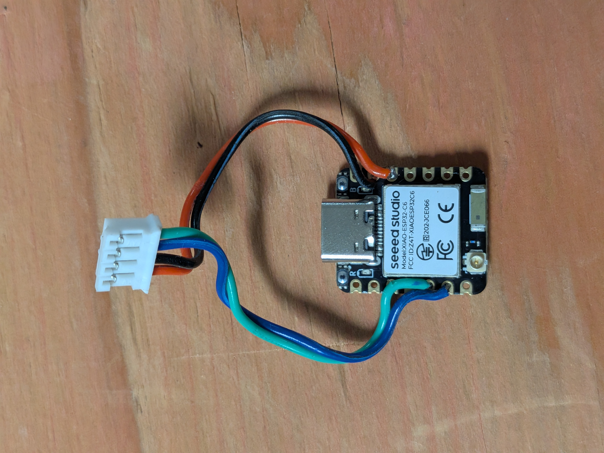
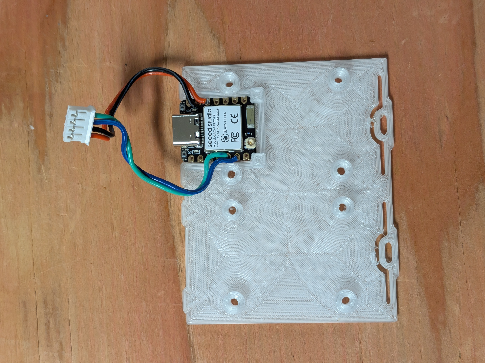
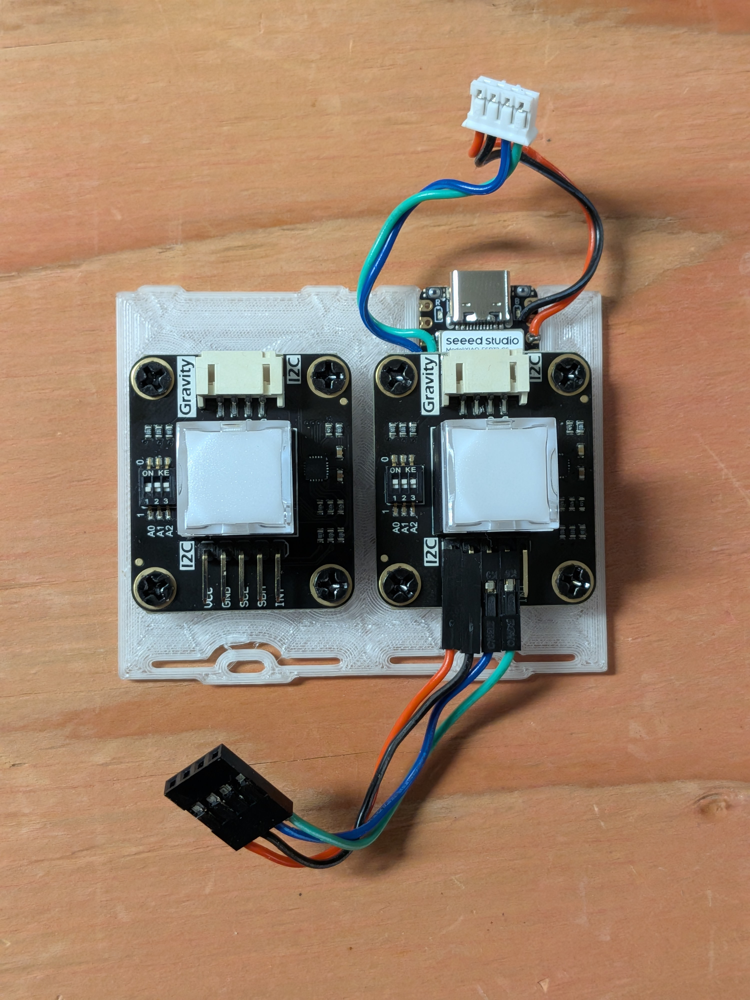
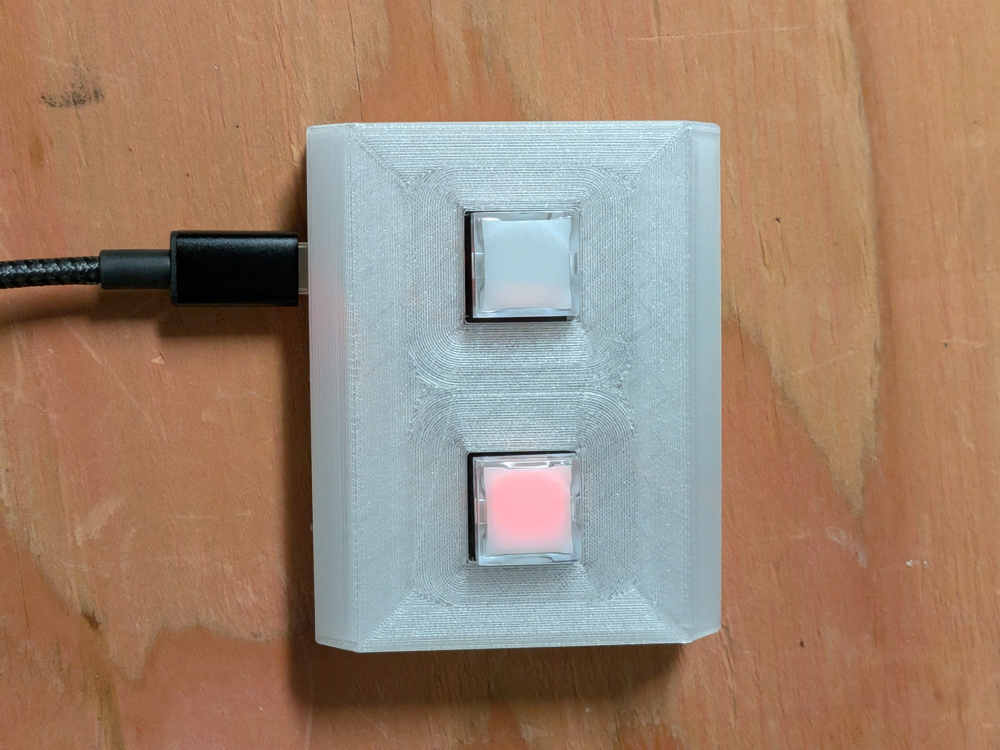

# Simple Parametric Enclosure for Milieu Panel

A 3D-printable parametric enclosure for the **Seeed Studio XIAO ESP32-C6** and **1 to 4+ DFRobot `DFR0991` RGB LED buttons**.

---

## Hardware Required

* **4x M3×6 screws** per button module
* **Hookup wire & connectors** for each `DFR0991` button (each module supports two connector types):
  * **Gravity PH2.0 4-pin (`JST PH2.0-4P`)** — `D` (SDA), `C` (SCL), `+` (VCC), `-` (GND)
  * **2.54 mm 5-pin header (DuPont)** — `D` (SDA), `C` (SCL), `+` (VCC), `-` (GND), and `INT` *(unused)*

> [!TIP]
> Each `DFR0991` ships with a **PH2.0-to-DuPont** cable. Cutting those cables to length and crimping/adding DuPont connectors is usually the cheapest and tidiest way to wire up the bus.

---

## Enclosure Files

Standard slicer defaults for your printer (e.g., `0.2 mm` layer height, PLA/PETG) should work well.

| File | Description |
|------|-------------|
| [Milieu_Panel_V1.f3d](./Milieu_Panel_V1.f3d) | Parametric Fusion 360 source design (customize button count or tolerances) |
| [Milieu_Panel_1_Button_V1.step](./Milieu_Panel_1_Button_V1.step) | 1-button enclosure (`STEP`) |
| [Milieu_Panel_2_Button_V1.step](./Milieu_Panel_2_Button_V1.step) | 2-button enclosure (`STEP`) |
| [Milieu_Panel_3_Button_V1.step](./Milieu_Panel_3_Button_V1.step) | 3-button enclosure (`STEP`) |
| [Milieu_Panel_4_Button_V1.step](./Milieu_Panel_4_Button_V1.step) | 4-button enclosure (`STEP`) |

1. Solder the wires onto the board with the leads going top-down. Trim any excess wire from the bottom so the board fits into the slot on the 3D print. 

    

2. Push the board into the slot until it clicks and is held in place by friction. The edge of the board should align with the edge of the 3D print.

    

3. Install the buttons. Note: each button's I2C connector should be on the same side as the USB port. Wire everything up and test.

    

4. Install the cover. Keeping the cover nearly parallel to the base, gently work in the non-compliant edge first, then the compliant edge. If you find that too fiddly, you can optionally take the button tops off and place them back on after installing the cover.

    

